<!-- portrait:  python scripts/make_ascii_portrait.py <photo> --crop 470,160,930,690
     info card: python scripts/make_info_card.py -->

<h3><code>vishnu@github ~ $ whoami</code></h3>

<table>
<tr>
<td valign="top"></td>
<td valign="top"></td>
</tr>
</table>

 

<!-- real contribution data, refreshed daily by .github/workflows/update-contributions.yml -->

<h3><code>vishnu@github ~ $ ./contributions.sh</code></h3>

 
 

<h3><code>vishnu@github ~ $ ./links.sh</code></h3>

<b>Software Engineer · Android · Full Stack · Embedded &amp; Edge AI</b>

 

<h3><code>vishnu@github ~ $ ls ~/projects</code></h3>

| Project | What it demonstrates |
|---------|----------------------|
| [Cosmos](https://github.com/VishnuViez/Cosmos) | Self-hosted AI workspace: chat, agents, research, documents and local models |
| [Dispute-Desk](https://github.com/VishnuViez/Dispute-Desk) | AI agent that helps bank analysts investigate card disputes (IBM SkillsBuild AI Lab) |
| [smartpdf](https://github.com/VishnuViez/smartpdf) | PDF toolkit to edit, convert and protect files, with Gemini OCR and Stripe plans |
| [Employee-Management-CRUD](https://github.com/VishnuViez/Employee-Management-CRUD) | Full-stack Node.js + MongoDB app with a REST API and Docker Compose |
| [Clank Keys](https://github.com/VishnuViez/clank-keys-releases) · [site](https://clankkeys.web.app) | Mac app that plays mechanical keyboard sounds matched to how hard you type |
| [MovieProApp](https://github.com/VishnuViez/MovieProApp) | Android app in Java on MVVM with Retrofit and the TMDB API |

